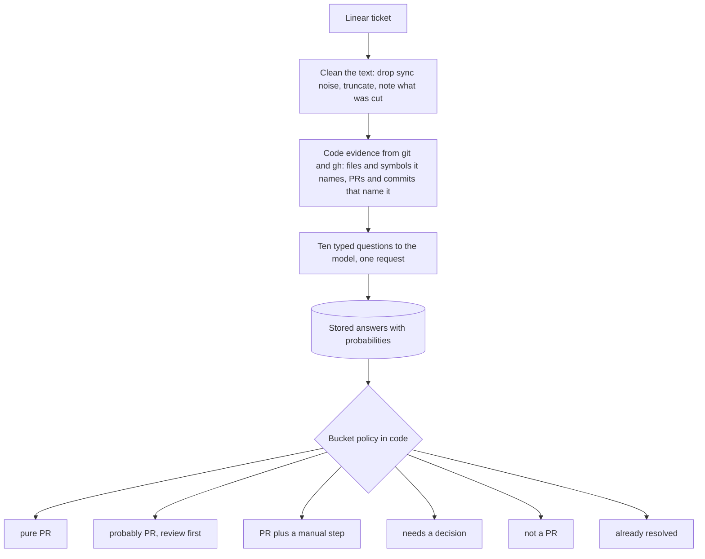

# ticket-triage

Decides which tracker tickets a pull request alone can resolve, so an agent pipeline only picks up work it can actually finish. It asks a model narrow, typed questions about each ticket, gives it evidence that code computes from the repository, and makes every decision in code. A companion labeler infers a ticket's type and scores how workable, ambiguous, large, risky and locatable it is.

It was built as the intake step for [linear-pipeline](https://github.com/gcp-bulqit/linear-pipeline), an agent system that takes Linear tickets to reviewed draft pull requests, and was evaluated against what that pipeline actually shipped.

## How it works



- **The model answers questions; code decides.** One multiple-choice question asks what resolving the ticket requires; eight yes/no questions check it (must the repo change? must someone act outside it? is a decision open? is a production investigation needed? does the evidence show it is already done?); one score estimates size. A `bucket()` function turns the stored probabilities into a bucket with explicit thresholds.
- **Policy changes are free.** Answers are stored, so `--rebucket` re-applies a changed policy without a single model call.
- **Facts beat readings.** The tool checks whether the files and identifiers a ticket mentions exist on the base branch, and whether a pull request or commit names the ticket. "A merged PR naming the ticket is a fact, not a reading."
- **Evaluation without hindsight.** `--eval` scores the buckets against tickets with known outcomes, judging each ticket only on what was known when work began: comments added after pickup are dropped and links to its eventual pull request are withheld.

The model is [TypeSafe's Jev](https://typesafe.ai), which answers typed questions with probabilities rather than text. All calls go through one module (`ticket_triage/jev.py`) behind a small interface, so another backend can be added there.

Details, diagrams and the design's evolution are in [docs/how-it-works.md](docs/how-it-works.md) and [docs/design-history.md](docs/design-history.md).

## Results

Against 54 tickets whose outcome was known from the pipeline's records (28 shipped a pull request, 26 closed without code), judged as of pickup:

| Counting as "a PR" | Precision | Recall |
|---|---|---|
| pure PR, plus probably PR | 63.6% (14 of 22; 95% interval roughly 43–80%) | 50.0% (14 of 28) |
| pure PR only | 66.7% | 35.7% |

Most misses went to "needs a decision", and most false positives were tickets decided or done elsewhere after pickup. Used as a shortlist, 33 of 43 picks shipped as pull requests; that run cannot be separated from other changes to the pipeline, as [docs/evaluation.md](docs/evaluation.md) explains along with every other number's scope, method and caveats.

## Install

Python 3.8 or later; no third-party packages.

```sh
git clone https://github.com/gcp-bulqit/ticket-triage.git
cd ticket-triage
python -m pip install .        # optional: adds the ticket-triage and ticket-label commands
```

Set `LINEAR_API_KEY` (a read-scoped Linear key) and `TYPESAFE_API_KEY`. Code evidence needs `git` and an authenticated GitHub CLI (`gh`), run from inside the target repository.

## Usage

Describe your repository once, in terms of what a pull request to it can and cannot change (see `examples/repository.example.json`; it is sent to the model, so describe the codebase, not your business):

```sh
# Triage a person's or bot's open tickets, or named tickets
python -m ticket_triage.triage --repository repository.json --assignee "Pipeline Bot" --states Todo,Backlog
python -m ticket_triage.triage --repository repository.json --ids ENG-101,ENG-102

# Change the policy and re-score stored answers, without new calls
python -m ticket_triage.triage --rebucket

# Hand the results to linear-pipeline: merges verdicts into .agent/triage.json
python -m ticket_triage.triage --rebucket --emit-triage

# Evaluate against known outcomes (see examples/labels.example.json); --no-evidence for the baseline
python -m ticket_triage.triage --repository repository.json --eval labels.json

# Labeler: infer type and dimension scores, backtest against shipped work, audit
python -m ticket_triage.label --taxonomy taxonomy.json --ids ENG-101,ENG-102
python -m ticket_triage.label --taxonomy taxonomy.json --backtest --outcomes outcomes.json
python -m ticket_triage.label --taxonomy taxonomy.json --audit backtest.json
```

Outputs go to `.agent/ticket-triage/` and `.agent/ticket-label/`: `results.json` (raw answers, evidence and bucket per ticket) and `report.md`. Run with `--help` for every option, including the issue-key pattern, base branch, pathspec and the patterns used to drop integration comments.

`--emit-triage` writes "pure PR" and "probably PR" tickets as `CODE` (add `--emit-exclude-likely` to send "probably PR" as `AMBIGUOUS` instead), and never overwrites an existing row. The labeler never writes to Linear: `--apply` is deliberately not wired.

## What leaves your machine

Ticket titles, descriptions and recent comments, your repository description, and the computed evidence are sent to TypeSafe's API for every ticket. Comment authors are replaced with pseudonyms unless you pass `--include-comment-authors`, and existing tracker labels are withheld unless you pass `--include-labels`. Check your organisation's data policy and TypeSafe's terms before running it on a real backlog. Outputs contain ticket text and are ignored by git.

## Tests

```sh
python -m unittest discover -s tests
```

The tests run offline against synthetic fixtures, with a fake model backend.

## Repository layout

| Path | What it is |
|---|---|
| `ticket_triage/triage.py` | Triage: questions, bucket policy, rebucket, eval, triage.json export |
| `ticket_triage/label.py`, `taxonomy.py` | Labeler: type and dimension scoring, routing, backtest, audit, effort calibration |
| `ticket_triage/evidence.py` | Code evidence from git and gh |
| `ticket_triage/linear.py`, `prepare.py` | Fetching and cleaning tickets |
| `ticket_triage/jev.py` | The only module that calls the model |
| `ticket_triage/metrics.py` | Precision, recall, F1 and Wilson intervals |
| `examples/` | Repository description, taxonomy, labels and outcome formats, synthetic fixtures |
| `docs/` | How it works, design history, evaluation, lessons |

## License

MIT, see [LICENSE](LICENSE). Not affiliated with TypeSafe; see [THIRD_PARTY_NOTICES.md](THIRD_PARTY_NOTICES.md).
