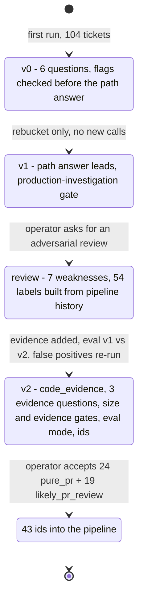

# Design history

How the triage classifier and the labeler got to their current shape. Both were built in October 2026
for an agent pipeline ([linear-pipeline](https://github.com/gcp-bulqit/linear-pipeline), published separately) that shipped pull requests against a
production TypeScript monorepo at a startup. The classifier went through three versions in about ten
minutes of wall-clock time on one day; the labeler went through three iterations in one session three
days later.

No version-control history exists for the original scripts. The evolution below is reconstructed from
a snapshot of the v1 script taken just before the v2 edit and from the build sessions, and the
reconstruction is checked numerically: applying the recovered v0 and v1 policies to the stored v1
answers reproduces the bucket counts reported at the time, exactly.

## Contents

1. [Before the classifier: a rule](#1-before-the-classifier-a-rule)
2. [v0: six questions](#2-v0-six-questions)
3. [v1: a policy-only fix](#3-v1-a-policy-only-fix)
4. [The adversarial review](#4-the-adversarial-review)
5. [v2: code evidence and an honest evaluation](#5-v2-code-evidence-and-an-honest-evaluation)
6. [Into the pipeline](#6-into-the-pipeline)
7. [The labeler: three backtests](#7-the-labeler-three-backtests)
8. [Folding Improvement into Enhancement](#8-folding-improvement-into-enhancement)
9. [Choices left open](#9-choices-left-open)

---

## 1. Before the classifier: a rule

Through September the pipeline drew tickets from two queues: one person's and a bot identity's. A real
fraction of those tickets were not code. Each still cost a discovery stage, and many ended in a
decision brief posted to a shared ticket.

The first response, in mid-September, was a configuration rule rather than a model:
`codeChangesOnly`. Only tickets whose resolution would produce a commit in this repository are queued.
Everything else is left where it is, and gets no comment of any kind. The pipeline's own documentation
puts it this way: "That silence is the point of the rule, so a run that comments on one has broken it
even if it queued nothing." The supervisor applied the test itself and cached its verdicts in
`.agent/triage.json`.

That handled the bot's queue. It did not answer the question asked on 2 October, when the pipeline
had just become concurrent: of 104 open tickets in one person's queue, which can be done purely with
a PR? Answering inside the supervisor would have cost context and given no probabilities and no way to
re-tune, so the answer was a separate, offline classifier.

## 2. v0: six questions

The request was for a classifier using a ticket's title, description and comments to decide which
tickets could be done purely with a PR. Before writing it, the session read the model provider's live
documentation (the API reference, the pages on choice and yes/no questions, and a page on where the
model's answers are uneven) and tested the endpoint with a single call.

v0 asked six questions and bucketed the answers in code. The first run over 104 tickets finished in
about 4 seconds of wall-clock time with 8 worker threads, using 210,475 input tokens.

Its policy had a bug that the counts made visible. It checked `pr_plus_ops` before `needs_decision`,
and never consulted the path answer for `ops_only` or `question_or_info`. Result: 28 tickets in
`pr_plus_ops` and only 8 in `not_pr`.

## 3. v1: a policy-only fix

About a minute later the policy was rewritten so that the path answer leads and the flags only break
ties, and `pure_pr` gained a gate: nothing may need investigating in production first
(`needs_prod_investigation < 0.5`).

No new model calls were made. The new policy was re-applied to the stored answers.

| Bucket | v0 policy | v1 policy |
|---|---:|---:|
| `pure_pr` | 31 | 28 |
| `likely_pr_review` | 11 | 14 |
| `pr_plus_ops` | 28 | 13 |
| `needs_decision` | 23 | 31 |
| `not_pr` | 8 | 15 |
| `already_resolved` | 3 | 3 |

The session checked the result against the supervisor's earlier hand triage. Nine tickets were in
both; the supervisor had called all nine not-code or ambiguous, and all nine landed outside the PR
buckets. It also flagged what it could not see: one `pure_pr` ticket that looked already delivered by
earlier work, and two tickets scored near "epic" that were still `pure_pr` because size did not gate
anything.

## 4. The adversarial review

The operator then asked for an adversarial review of the classifier, and suggested giving it a small
view of the codebase. The review listed seven weaknesses, most serious first:

1. **No positive labels.** The thresholds were guesses.
2. **The model never sees the codebase.** A fix merged under another ticket still reads as open work.
3. **Size never gates the bucket.**
4. **The pipeline's own comments leak into the input.** Agent briefs and status notes on a ticket mean
   the classifier partly grades the pipeline's own output.
5. **Silent failures.** Errors went to stderr only.
6. **A hidden policy choice.** The pure-PR definition counted a worker redeploy as part of a normal
   deploy, while the repository's own notes said it was a separate manual step.
7. **Truncation without notice.** The model was not told when comments had been dropped.

## 5. v2: code evidence and an honest evaluation

v2 addressed five of the seven. Weakness 4 was handled only in the evaluation (by the cut at pickup,
below), and weakness 6 was left as a documented choice.

- **A labelled set and an evaluation mode (fixes 1).** 54 tickets with a known outcome, built from the
  pipeline's history: 28 that shipped a PR, 26 that were closed without code or triaged not-code.
- **Code evidence (fixes 2).** A `code_evidence` object computed by code from git and the code host,
  and three questions that read it: `evidence_shows_done`, `requested_thing_exists`,
  `fix_location_known`.
- **Gates (fixes 3).** `size < 3.0`, `evidence_shows_done < 0.4` and `requested_thing_exists < 0.5`
  for `pure_pr`; and a rule that sends a ticket to `already_resolved` when the model reads it as done
  *and* a merged PR names it.
- **A build-artifact filter.** A spot check showed bundler chunk names from a pasted stack trace being
  looked up as files.
- **Failures listed at the top of the report (fixes 5)**, and an `earlier_comments_omitted` field in
  the state (fixes 7).

`requested_thing_exists` came out of the spot check. The ticket that v1 had flagged as probably
already delivered came back `pure_pr` again, with `evidence_shows_done` at 0.06, because no PR named
it. But the evidence did show that the files and functions it asked for already existed. A new
question, "for a request to build something new, does the evidence show it already exists?", scored
it 0.73 and moved it to `likely_pr_review`.

**Judged only on what was known at pickup.** The evaluation's leakage control is the part of v2 most
worth copying. Each ticket is judged on the comments that existed before work began, and links from
the ticket id to PRs and commits are withheld. Otherwise the label leaks into the state: a comment
saying "fixed in PR 123" or a merged PR naming the ticket would let the classifier read the answer.

**What v2 changed.** 12 of 104 tickets moved bucket. Only 2 of those moves came from the new gates
applied to old answers. The other 10 came from the model's answers moving because the state and the
question set had changed, by small amounts (mean absolute shift 0.007 to 0.030 on the shared yes/no
questions). The session's reading at the time: "Any single bucket is a coin-flip near the thresholds."
Input tokens rose 37.8%, from 210,475 to 289,978 for the run.

**Why evidence barely moved the evaluation.** On the 54 labelled tickets, v1 and v2 were nearly
identical: same recall, one fewer false positive for v2, 2 of 54 buckets different. That is expected,
not disappointing. The evidence's main mechanism is a merged PR or commit that names the ticket, and
the evaluation withholds exactly those links. In the session's words: "The evidence only helps with
duplicates and already-merged work in live runs, and the eval deliberately hides the id links. So the
gain is real but anecdotal." The anecdote: re-running the five `pure_pr` false positives with live
comments and evidence turned four of them into `already_resolved`. Full numbers are in
[evaluation.md](evaluation.md).

The session's conclusion was to "treat it as a shortlist to review, not a list to hand straight to the
pipeline."

## 6. Into the pipeline

The operator accepted the v2 output whole: 24 `pure_pr` and 19 `likely_pr_review`, 43 tickets. They
went into the pipeline through two explicit doors: a new ingest source with an `ids` list (at any
priority, by explicit choice, although the operator's other source excluded urgent tickets), and 43
`CODE` rows in `triage.json`. The `ids` field was documented in the pipeline's intake section at the
same time. 38 of the 43 tickets were moved from backlog to a ready state, with state changes only, no
comments and no reassignment. The five-slot concurrent run started two minutes later on that queue.

What happened to them is in [evaluation.md](evaluation.md#5-the-shortlist-outcome), with the confound
that prevents reading it as the classifier's effect.

## 7. The labeler: three backtests

Three days later the operator asked to iterate on triage using the tracker's labels. The session found
that labels were passed to the model but read by no question, audited the label descriptions (fewer
than a third of labels had one), proposed a target taxonomy, and built a separate labeler.

The labeler's design choices came first: label descriptions in the form "what it is, what it excludes,
its nearest neighbour"; the human label withheld from the model; five dimensions kept separate, each
naming the artifact that scores it, or none; and routing in code. See
[how-it-works.md](how-it-works.md#8-the-labeler). Then three iterations, in one session:

**Backtest 1.** 175 tickets that had a pipeline artifact folder.

- Label agreement with the human label: type 60.5%, functional area 66.7%, product surface 83.8%,
  runtime 9.7%. The runtime figure was the session's own mapping bug: an old location label had been
  read as a runtime, when it really meant "roughly back-end". Checking which files those tickets
  touched showed it.
- A `rework` score (predicted review cycles) came out at about 2.6 regardless of the actual number of
  cycles. No signal.
- `ambiguity` against "a decision brief was written": precision 73.9%, recall 21.2%.
- `workability` against "produced a PR": precision 83.1%, recall 86.9%, on a 74% base rate.
- Routing separated the populations: `ready` tickets produced a PR 90% of the time and needed a
  decision brief 22% of the time; `needs_ops_step` tickets 44% and 56%.

**Four fixes, then backtest 2.**

1. Remove the bad runtime mapping.
2. Drop `rework`.
3. Ask effort as a magnitude and band it in code, rather than asking for a band.
4. Score `ambiguity` against "a person had to answer a question" instead of "a decision brief was
   written". The decision brief is produced by pipeline policy as much as by genuine ambiguity, so it
   measured the process, not the property.

Results were mixed, and the session said so. The effort change did not help (51.5% to 50.5% exact
band; 94.8% within one band), because the band edges had been fitted on an earlier question's spread.
It declined to refit them on the same data: "I don't want to fit thresholds on the same data I then
report — that's just memorising the test set." Dropping `rework` from the `ready` rule widened `ready`
from 41 to 68 tickets and diluted it (90% to 85% produced a PR; 22% to 35% needed a decision brief).
The session's verdict on its own change: "I removed it on evidence that only showed it didn't predict
the thing I'd guessed it predicted."

**Relabel from what shipped.** Label agreement measures the model against the human label, but which
one is right? "The ticket text is what the humans mislabelled from, so it cannot arbitrate its own
label." The merged PR body describes what the change actually did. So the session asked the model to
classify each of the 130 shipped tickets from its merged PR body alone, against the same type
criteria. Judged that way, human type labels agreed with the outcome 53.8% of the time (49 of 91 that
had a type label), and the model reading only the ticket text agreed 70.8% (92 of 130).

## 8. Folding Improvement into Enhancement

One type label stood out in the relabel. As an outcome, `Improvement` was 11 of 130 tickets, at the
lowest mean confidence of any type (0.56, against 0.73 for `Enhancement`). Its runner-up types were
spread across Bug (5), Enhancement (4), Refactor (1) and Cleanup (1), and it accounted for 15 of the 42
disagreements between human labels and outcomes. It was not a kind of change. It was where small
polish work went, with no stated boundary against `Enhancement`.

It was retired and folded into `Enhancement`. Human agreement with the outcome rose from 53.8% to
64.8%: more than any prompt change in the session moved any number. With the fold applied, 32 of the
130 shipped tickets have a corrected type that differs from the human label; what that figure does and
does not mean is in [evaluation.md](evaluation.md#6-type-label-backtest).

The corrected types reached the tracker, but not through this tool. At the operator's instruction, the
session wrote label changes with one-off scripts after saving a copy of every affected ticket's
labels. That was an operator decision. The labeler's own apply mode is deliberately not wired to
tracker writes.

## 9. Choices left open

- **What "deploy" includes.** The pure-PR definition must say whether a worker redeploy or a manual
  migration counts as part of a normal deploy. It differs by repository, and the original got it wrong
  for its own.
- **Which buckets count as `CODE`.** The original run sent both `pure_pr` and `likely_pr_review` into
  the pipeline, after review. A more conservative setup sends only `pure_pr`.
- **Thresholds.** Every number in `bucket()` and `route()` was set by hand. 54 labels can check them;
  they cannot tune them without overfitting.
- **Pinning the model version.** Requests asked for the alias `jev-latest`, which answered as
  `jev-1.13.0` on every call. Once thresholds are tuned against one version, pin it; the provider's
  documentation recommends the same.
