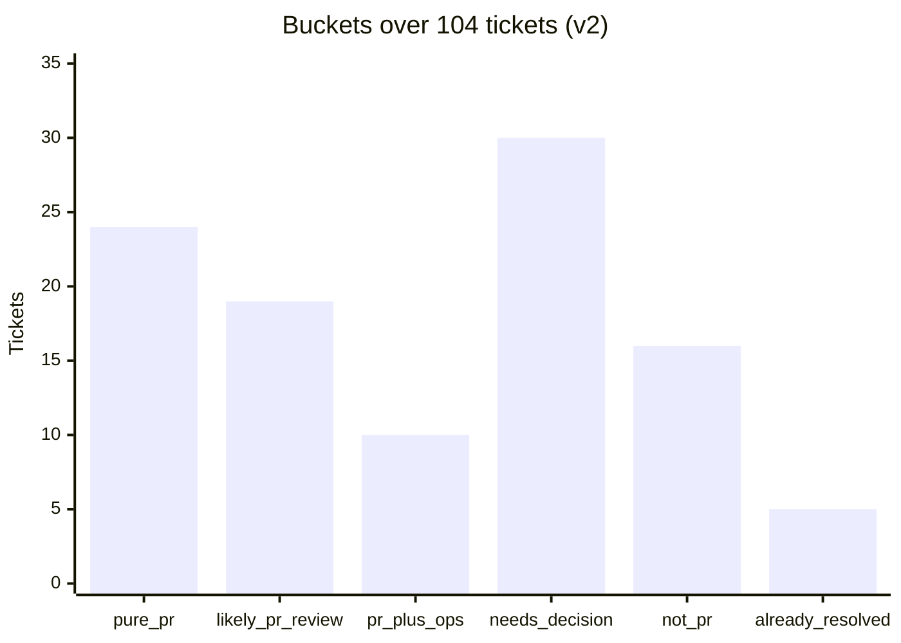
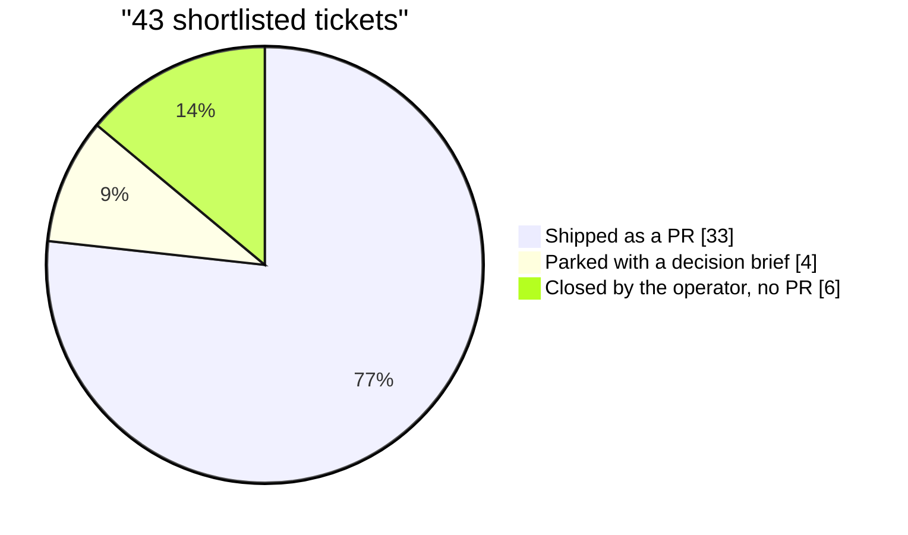
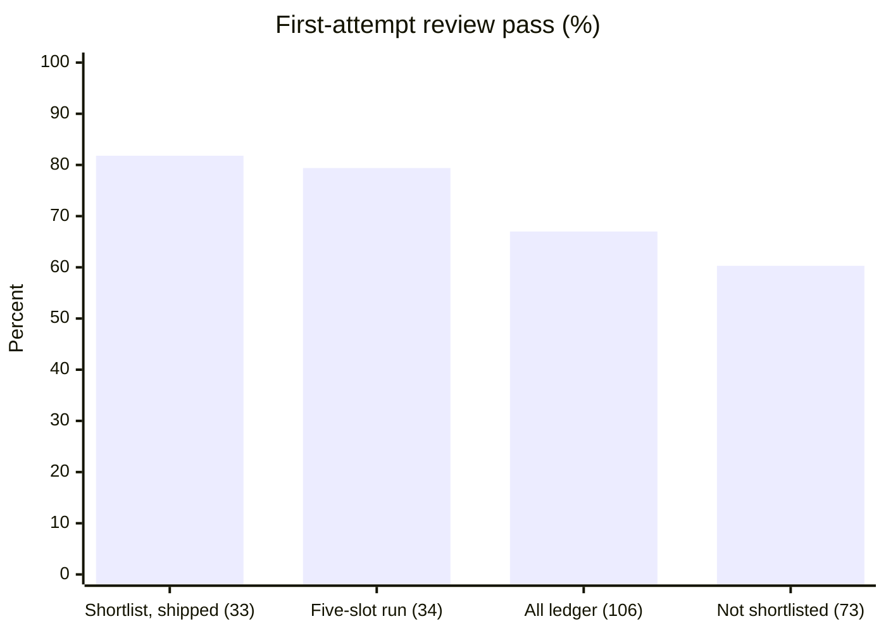
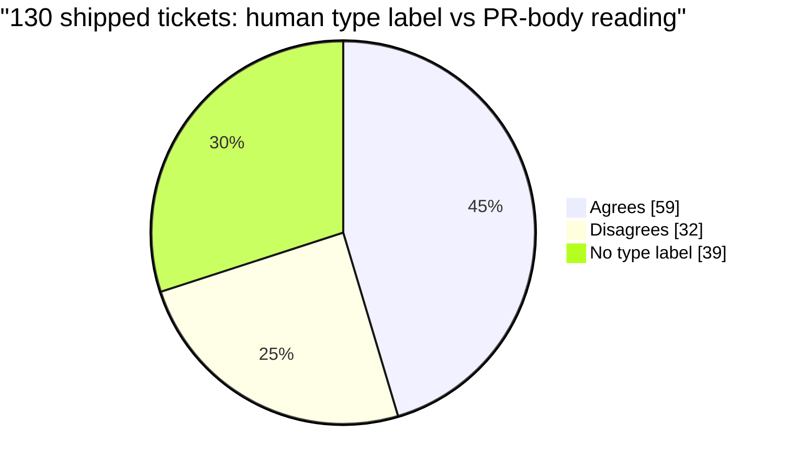

# Evaluation

What was measured, how, and what each number does not show. All figures come from one person's
backlog on one production TypeScript monorepo at a startup, in October 2026, with the model answering
as `jev-1.13.0`. They describe what the tool did there; they are not a benchmark.

Every figure is tagged:

- **measured**: counted from the tool's stored output files, the pipeline's state files, or a tracker
  export.
- **inferred**: derived with an assumption stated beside it.

Percentages are of the stated n. Intervals are 95% Wilson score intervals. No ticket, PR or person is
identified anywhere in this document.

## Contents

1. [Summary](#1-summary)
2. [The run](#2-the-run)
3. [Evaluation against labelled history](#3-evaluation-against-labelled-history)
4. [v1 against v2](#4-v1-against-v2)
5. [The shortlist outcome](#5-the-shortlist-outcome)
6. [Type-label backtest](#6-type-label-backtest)
7. [Labeler dimensions and routing](#7-labeler-dimensions-and-routing)
8. [Not measured](#8-not-measured)

---

## 1. Summary

| Result | Value | Scope | Kind |
|---|---|---|---|
| Precision, `pure_pr` or `likely_pr_review` | **63.6%** (14/22), CI 43.0–80.3% | 54 labelled tickets, judged as of pickup | measured |
| Recall, same definition | **50.0%** (14/28), CI 32.6–67.4% | same | measured |
| Precision / recall, `pure_pr` only | 66.7% (10/15) / 35.7% (10/28) | same | measured |
| Misses called `needs_decision` | 10 of 14 | same | measured |
| `pure_pr` false positives that were later decided or done elsewhere | 4 of 5 | re-run with live comments and evidence | measured |
| Shortlisted tickets that shipped as PRs | 33 of 43 | the 43-ticket shortlist | measured |
| First-attempt review pass, shipped shortlist PRs | 81.8% (27/33) | **confounded with a concurrent run; see §5** | measured |
| Human type labels that disagree with the model's reading of the merged PR | 32 of 91 labelled (35.2%); 24.6% of all 130 | shipped tickets, after one label fold | measured |

The short version: a useful shortlist, a poor oracle. It found half of the PR-able tickets, and about
two of every three tickets it put forward were PR-able. Most of its misses went to "needs a
decision", and most of its strict false positives were tickets that were decided or done elsewhere
after pickup.

## 2. The run

**Scope:** one triage run over 104 open tickets (23 in a ready state, 81 in backlog), final version
(v2). **Method:** counted from `results.json`; re-applying the stored policy to the stored answers
reproduces every stored bucket (measured).

| Measure | Value |
|---|---|
| Path answer | `pr_only` 50, `pr_plus_ops` 19, `decision_first` 16, `question_or_info` 9, `ops_only` 7, `already_resolved` 3 |
| Flags at ≥ 0.5 | `needs_repo_change` 87, `needs_decision` 39, `needs_outside_step` 38, `needs_prod_investigation` 28, `fix_location_known` 40, `already_resolved` 4, `evidence_shows_done` 2, `requested_thing_exists` 1 |
| Size score (0 tiny to 4 epic) | median 1.55, mean 1.7; 9 tickets at 3.0 or above |
| Code evidence | 35 tickets named a file (96 of 103 files existed); 38 named a symbol (187 of 203 found); 5 had a PR naming them (4 merged); 14 had a base-branch commit naming them |
| Input tokens per ticket | mean 2,788, median 2,454, max 4,322 |

**Caveat.** One person's queue, one repository. The path answer and the flags are the model's
judgments; the buckets are code.

## 3. Evaluation against labelled history

**Scope:** 54 tickets with a known outcome. **Labels** (measured): 28 positive (the pipeline shipped a
PR for the ticket) and 26 negative (closed with no code, or triaged not-code). The labels were derived
from the pipeline's own records of what happened to each ticket, not by a person reading each ticket.

**Method.** Leakage control: each ticket is judged on the comments that existed before work began, and
links from the ticket id to PRs and commits are withheld, so the evidence holds only the file and
symbol lookups. The classifier sees roughly what a person would have seen at pickup.

**v2, with `pure_pr` or `likely_pr_review` counted as "PR"** (the shortlist definition):

| | Labelled PR | Labelled no PR |
|---|---:|---:|
| **Predicted PR** | TP 14 | FP 8 |
| **Predicted not PR** | FN 14 | TN 18 |

Precision 63.6% (CI 43.0–80.3%), recall 50.0% (CI 32.6–67.4%), F1 56.0%, accuracy 59.3%,
false-positive rate 30.8%, n = 54.

**v2, `pure_pr` only:**

| | Labelled PR | Labelled no PR |
|---|---:|---:|
| **Predicted PR** | TP 10 | FP 5 |
| **Predicted not PR** | FN 18 | TN 21 |

Precision 66.7% (CI 41.7–84.8%), recall 35.7% (CI 20.7–54.2%), F1 46.5%, accuracy 57.4%,
false-positive rate 19.2%, n = 54. Narrowing to `pure_pr` buys a little precision and costs a third
of the recall; the intervals overlap almost entirely.

**Where the misses go** (measured). Of the 14 shipped tickets not called PR, 10 were called
`needs_decision`. Splitting the positives by whether the pipeline wrote a decision brief before
shipping: `needs_decision` caught 7 of the 11 that did need a decision first, and the PR buckets caught
11 of the 17 that shipped without one. So the classifier under-calls PR work mostly by asking for a
decision that a person later made.

**Where the false positives come from** (measured). The 5 `pure_pr` false positives were re-run
without the evaluation's withholding. 4 came back `already_resolved`: all 4 through comments written
after pickup, and 1 of them also through a merged PR naming the ticket. Most false positives were
tickets decided or done elsewhere after work began, which an as-of-pickup evaluation cannot see.

**Caveats.**

- n = 54. The precision interval spans 43–80%. These labels can check the thresholds; they cannot
  tune them.
- The labels come from the pipeline's history, so every ticket had been picked up by the pipeline or
  triaged by its supervisor. That is not a random sample of a backlog.
- No second person labelled anything, so there is no inter-rater agreement.
- Some negatives were closed because the work was decided or done elsewhere after pickup (4 of the 5
  `pure_pr` false positives, below). Judged as of pickup, those count against the classifier, and that
  is the intended, conservative reading.

## 4. v1 against v2

**Scope:** the same 54 labels, run once without evidence (v1) and once with it (v2).

| | v1 (no evidence) | v2 (evidence) |
|---|---:|---:|
| TP / FP / FN / TN | 14 / 9 / 14 / 17 | 14 / 8 / 14 / 18 |
| Precision | 60.9% (CI 40.8–77.8%) | 63.6% (CI 43.0–80.3%) |
| Recall | 50.0% | 50.0% |
| False-positive rate | 34.6% | 30.8% |
| Buckets that differ | | 2 of 54 |

**Why evidence barely moved the evaluation.** The evidence's main mechanism is a merged PR or a commit
that names the ticket. The evaluation withholds exactly those links, by design, to stop the label
leaking into the state. What remains is the file and symbol lookup, which helps only when a ticket
names the right files or functions. So this evaluation shows that adding evidence did no harm; it
cannot show what the evidence is worth on already-merged work. The only measurement of that is the
false-positive re-run in §3.

**Answers move when the state changes** (measured, over the full 104-ticket run). Going from v1 to v2,
12 of 104 tickets changed bucket. 2 of those changes came from the new gates applied to the old
answers; the other 10 came from the answers themselves moving. The mean absolute shift on the shared
yes/no questions was 0.007 to 0.030, and the path choice flipped on 2 tickets. Small shifts near a
threshold flip buckets, so a run-to-run comparison of buckets overstates what changed.

| Bucket | v1 policy, v1 answers | v2 policy, v1 answers | v1 policy, v2 answers | v2 (shipped) |
|---|---:|---:|---:|---:|
| `pure_pr` | 28 | 26 | 27 | 24 |
| `likely_pr_review` | 14 | 16 | 16 | 19 |
| `pr_plus_ops` | 13 | 13 | 11 | 10 |
| `needs_decision` | 31 | 31 | 30 | 30 |
| `not_pr` | 15 | 15 | 16 | 16 |
| `already_resolved` | 3 | 3 | 4 | 5 |

**Cost of the evidence** (measured): input tokens for the 104-ticket run rose from 210,475 to 289,978
(+37.8%); mean per ticket from 2,024 to 2,788.

## 5. The shortlist outcome

**Scope:** the 43 tickets the operator accepted (24 `pure_pr`, 19 `likely_pr_review`), which became
the queue for a five-slot concurrent pipeline run. **Method:** each ticket's final disposition from
the pipeline's state files; review attempts from the pipeline's ledger of completed tickets.

| Outcome | `pure_pr` (24) | `likely_pr_review` (19) | Total |
|---|---:|---:|---:|
| Shipped as a PR | 19 | 14 | 33 |
| Parked or closed without a PR | 5 | 5 | 10 |

Of the 6 tickets closed without a PR, 3 were recorded as already done on the base branch: two from
`likely_pr_review` (one of them the ticket `requested_thing_exists` had flagged, queued anyway because
the whole bucket went in) and one from `pure_pr`. Evidence that matches on the ticket id cannot find
work shipped under another id.

**First-attempt review pass** (measured):

| Population | n | Attempts 1 / 2 / 3 / 4 | First attempt | 95% CI | Mean attempts |
|---|---:|---|---:|---|---:|
| Shortlisted, shipped | 33 | 27 / 4 / 2 / 0 | 81.8% | 65.6–91.4% | 1.24 |
| … of which `pure_pr` | 19 | 17 / 1 / 1 / 0 | 89.5% | 68.6–97.1% | 1.16 |
| … of which `likely_pr_review` | 14 | 10 / 3 / 1 / 0 | 71.4% | 45.4–88.3% | 1.36 |
| The five-slot run | 34 | 27 / 4 / 3 / 0 | 79.4% | 63.2–89.7% | 1.29 |
| All pipeline PRs in the ledger | 106 | 71 / 26 / 8 / 1 | 67.0% | 57.6–75.2% | 1.42 |
| Ledger PRs not on the shortlist | 73 | 44 / 22 / 6 / 1 | 60.3% | 48.8–70.7% | 1.51 |

**This is not the classifier's effect.** All but one of the five-slot run's 34 PRs came from the
shortlist, and no shortlist ticket shipped outside that run, so "shortlisted" and "shipped in the
concurrent run" are the same set. That run came after a month of pipeline fixes and had its own
conditions (five slots, reviews started early). The "67% overall" baseline also counts the shortlist
itself; without it, the rest of the pipeline's history passed on the first attempt 60.3% of the time.
The confidence intervals overlap. The figure is consistent with an easier-than-average queue and
proves nothing about the classifier. Separating the two would have needed a control: unshortlisted
tickets run under the same conditions.

**Caveat on the tracker state.** At a tracker export three days later, unshortlisted buckets had
simply never been worked, so their status is not an outcome measure for them.

## 6. Type-label backtest

**Scope:** the 130 tickets that the pipeline shipped and that had a merged PR body; 91 of them carried
a human type label and 39 did not. **Method:** the model classified each ticket's type **from the
merged PR body alone**, against the same type criteria used for tickets. Then `Improvement` was folded
into `Enhancement` (see [design-history.md](design-history.md#8-folding-improvement-into-enhancement)),
and the result was compared with the human type label (measured).

What shipped, before the fold (measured): Bug 50, Enhancement 48, Improvement 11, Cleanup 8,
Refactor 5, Optimization 4, Feature 4.

| Comparison | Before fold | After fold |
|---|---:|---:|
| Human type label vs the model's reading of the PR body | 53.8% (49/91) | 64.8% (59/91) |
| Model reading only the ticket text vs the model's reading of the PR body | 70.8% (92/130) | 73.1% |

**Changed type** (measured): 32 of 130 tickets (24.6% of all) have a corrected type that differs from
the human label; that is 32 of the 91 with a type label (35.2%, CI 26.1–45.4%).

**What "wrong" means here.** It means the human label (with `Improvement` read as `Enhancement`)
differs from one model's reading of the merged PR body. It is a disagreement with a model's judgment
of the outcome, not a human ruling that the label was wrong. Of the 32 changes, 10 were made at
confidence below 0.5 and 11 at 0.8 or above. The largest flows were Bug to Enhancement (11) and
Enhancement to Bug (6): the line between "it does not do what it should" and "it should do more" is
where labels disagree most.

**Caveats.**

- The judge is the same model family as the ticket-text classifier, so the second row of the table is
  model against model.
- Selection bias: every ticket had shipped through the pipeline.
- A disagreement rate this high says more about the taxonomy than about the people using it. Two
  labels had no stated boundary between them, and one was used as a catch-all.

## 7. Labeler dimensions and routing

**Scope:** 175 tickets with a pipeline artifact folder: 130 produced a PR (74%), 80 had a decision
brief written (46%), and 12 needed a person to answer a question. Every ticket had already entered the
pipeline, so the population is selection-biased. **Method:** the model scores each ticket from its text
with labels withheld; each dimension is compared with the matching artifact (measured).

**Label agreement with the human label** (v2): type 61.3% (n = 119), functional area 65.6% (n = 90),
product surface 82.4% (n = 68), effort band 50.5% (n = 97).

| Dimension | Truth | Result |
|---|---|---|
| `workability` (≥ 0.5) | Produced a PR | Precision 82.6%, recall 87.7%, accuracy 77.1%. Always saying "yes" would score 74% accuracy (inferred), so the lift is modest |
| `ambiguity` (≥ 0.5), backtest 1 | Decision brief written | Precision 73.9%, recall 21.2% |
| `ambiguity` (≥ 0.5), backtest 2 | A person answered a question | Precision 22.7%, recall 41.7%, on 12 positives |
| `effort` | Human effort band | Mean score rises across bands (1.07, 1.42, 2.01, 2.79); exact band 50.5%, within one band 94.8% |
| `rework` (dropped) | Review cycles | Mean prediction 2.65, 2.36, 2.80, 2.72 for 0, 1, 2, 3 actual cycles: no signal |

**Routing** (v2):

| Route | n | Produced a PR | Decision brief written | Needed a human answer |
|---|---:|---:|---:|---:|
| `ready` | 68 | 58 (85%) | 24 (35%) | 2 |
| `needs_grooming` | 62 | 47 (76%) | 29 (47%) | 3 |
| `needs_ops_step` | 23 | 9 (39%) | 14 (61%) | 3 |
| `needs_decision` | 12 | 6 (50%) | 11 (92%) | 4 |
| `needs_care` | 10 | 10 (100%) | 2 (20%) | 0 |

`needs_ops_step` stays well below the 74% PR base rate in both backtests (44%, then 39%), and
`needs_decision` well above the 46% decision-brief base rate. The routes separate populations; on
this sample they do not do it by a wide margin.

**Caveat.** The `effort` band edges were fitted on an earlier question's spread and not refitted on
this data. Fit them on held-out history before trusting exact bands. The model's score is fine for
thresholds; reading exact magnitudes off it is not.

## 8. Not measured

- **Latency.** No output file records per-call latency. The only figure is wall clock from a session
  log: about 4.3 seconds for the first 104-ticket run, with 8 worker threads.
- **The evidence's value on work already merged elsewhere**, in a controlled evaluation. The
  evaluation withholds it by design.
- **A clean test of the shortlist's effect.** No held-out set of unshortlisted tickets was run under
  the same conditions.
- **Outcomes for unshortlisted buckets.** They were never worked.
- **Inter-rater agreement.** No second person labelled anything.
- **Cost.** Token counts are above. Prices change; check the provider's current price list rather than
  relying on a figure here.
