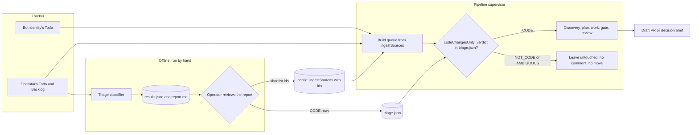
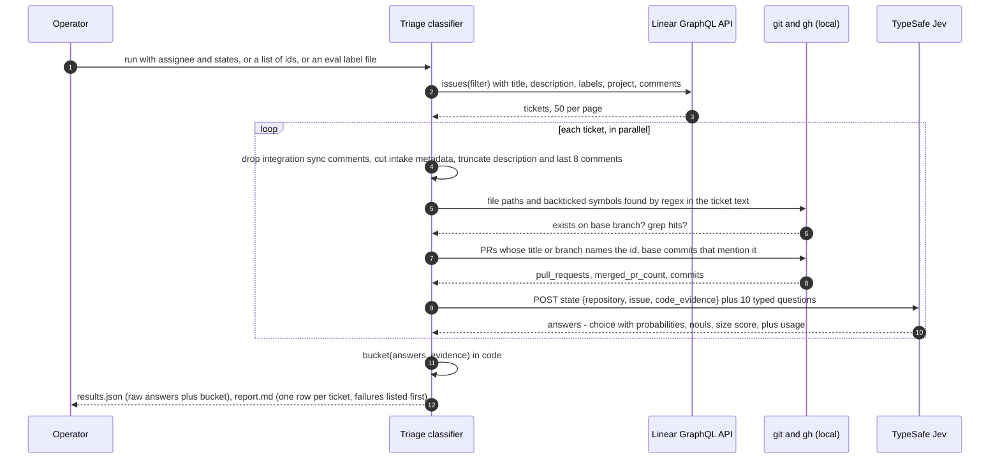
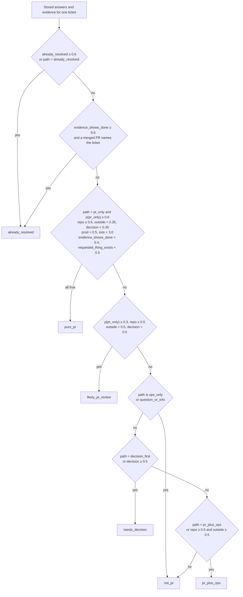
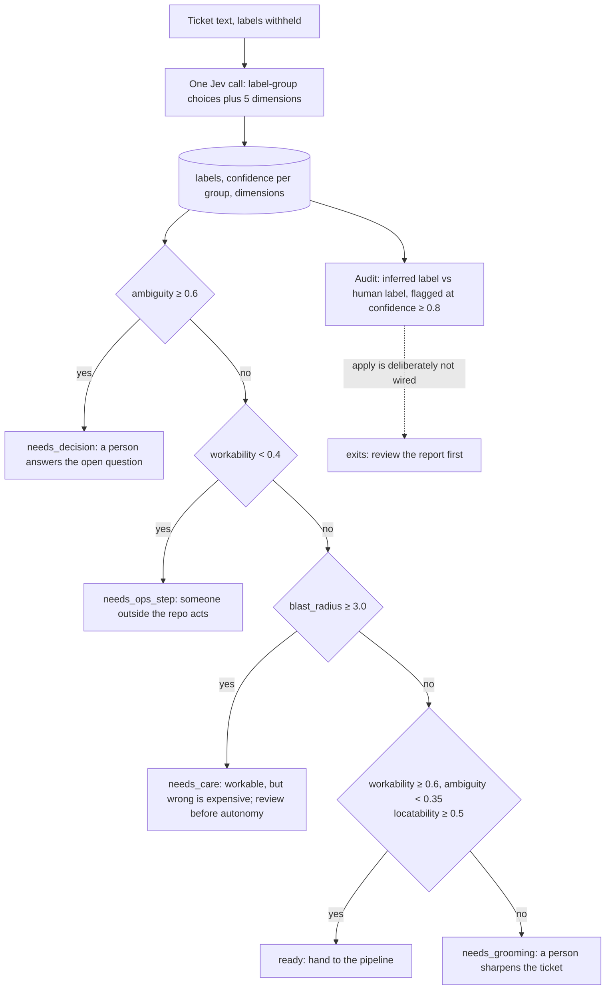

# How it works

This tool answers one question about each ticket in a Linear backlog: **can a pull request alone
resolve it?** It has two parts.

- The **triage classifier** sorts tickets into six buckets, from "pure PR" to "already resolved".
- The **labeler** infers a ticket's labels and scores it on a few separate dimensions (workability,
  ambiguity, effort, blast radius, locatability), then routes it.

Both ask a typed-judgment model narrow questions and get back probabilities. Neither lets the model
make the decision: thresholds, buckets and routes are plain code that reads stored answers.

The model is Jev, from TypeSafe (`https://api.typesafe.ai/v1/systemone`). Every run sends ticket text
(title, description, recent comments, and for some labeler modes merged pull request descriptions) to
that third-party service. The top-level README lists exactly what is sent and how to limit it.

## Contents

1. [The problem](#1-the-problem)
2. [Where triage sits](#2-where-triage-sits)
3. [One ticket, end to end](#3-one-ticket-end-to-end)
4. [The questions](#4-the-questions)
5. [The buckets](#5-the-buckets)
6. [Why the decision lives in code](#6-why-the-decision-lives-in-code)
7. [Outputs and modes](#7-outputs-and-modes)
8. [The labeler](#8-the-labeler)
9. [Plugging into the pipeline](#9-plugging-into-the-pipeline)
10. [Known limits](#10-known-limits)

---

## 1. The problem

The tool was built for an agent pipeline ([linear-pipeline](https://github.com/gcp-bulqit/linear-pipeline), published separately) that takes tracker
tickets through discovery, planning, implementation, a verify gate and review, and ends each one in a
draft pull request or a decision brief posted to the ticket. A pipeline like that will spend real time
on any ticket it is given. Many tickets in a real backlog are not code: they are already fixed, are a
setting in a third-party dashboard, need production data before anyone can say what is wrong, wait on
a product decision, or are questions.

Getting the call wrong costs in both directions.

- **Calling a non-code ticket "code"** spends a full discovery stage, and often ends with a decision
  brief posted to a ticket that a person owns. On a shared tracker, that is noise on someone else's
  work.
- **Calling a code ticket "not code"** leaves work that the pipeline could have done sitting in the
  backlog, unseen, because excluded tickets get no comment and no move.

The pipeline's first answer was a rule, not a model: `linear.codeChangesOnly`, which queues only
tickets whose resolution would produce a commit in this repository and says nothing at all on the
rest. That rule needs a verdict per ticket. The question that prompted this tool was broader: of
104 open tickets in one person's queue, which can be done purely with a PR? A judgement made inside
the supervisor's context over 104 tickets would have cost context, given no probabilities and offered
no way to re-tune. A separate, offline classifier could do all three.

## 2. Where triage sits

The classifier is not called by the pipeline. It runs by hand before a run, a person reviews its
report, and its output enters the pipeline through two existing, explicit doors: an ingest source
with an `ids` list, and the triage cache that `codeChangesOnly` reads.

The review step is not decoration. The classifier's bucket is a suggestion about a ticket a person
wrote, and the pipeline will act on it.

## 3. One ticket, end to end

All questions for a ticket go to the model in a single request and are answered independently of each
other. Tickets are processed in parallel (the original used 8 worker threads).

**1. Fetch.** One GraphQL query per page of 50, filtered by assignee and workflow state, or by an
explicit list of ids. Ticket text goes to the model and to the output files. It is not printed to the
terminal.

**2. Clean.** Comments that an intake integration writes under a person's account (status-sync lines)
are dropped by a configurable pattern. Descriptions can be cut where an intake tool appends session
details or console logs. The description is truncated at 3,500 characters, and only the last 8
comments are kept at 600 characters each. When earlier comments are dropped, the state says so
(`earlier_comments_omitted`), so the model knows it is reading a partial thread.

**3. Code evidence, computed in code.** Regular expressions find file paths and backticked
identifiers in the ticket. A filter drops build artifacts (bundler chunk names, stack-trace frames
pasted into a ticket). For each name, the classifier checks the base branch: does the file exist
(`git ls-tree`), and in how many files does the symbol appear (`git grep -w`). It also indexes pull
requests (`gh pr list`) and base-branch commits whose title, branch or message names the ticket id.
Over the original 104-ticket run, 35 tickets named a file (96 of 103 named files existed) and 38
named a symbol; 5 had a PR naming them (4 merged) and 14 had a commit naming them.

**4. State.** The request carries three objects:

| Object | Holds |
|---|---|
| `repository` | A hand-written description of what a pull request to this repository can and cannot change (`contains` / `does_not_contain`). You supply it; it is the most repository-specific input. |
| `issue` | Title, workflow state, project, description and comments. |
| `code_evidence` | The facts from step 3: named files and whether they exist, named symbols and their hit counts, PRs and commits that name the ticket. |

**5. Typed questions.** See [section 4](#4-the-questions).

**6. Bucket policy, in code.** `bucket()` reads the stored answers and evidence and returns one of
six buckets. See [section 5](#5-the-buckets).

**7. Outputs.** `results.json` and `report.md`. See [section 7](#7-outputs-and-modes).

## 4. The questions

One multiple-choice question, eight yes/no questions, and one score. A yes/no question returns a
probability of "yes"; a choice returns a probability per option; a score returns a
probability-weighted level that can fall between levels.

| Key | Type | Asks |
|---|---|---|
| `path` | choice | What resolving the ticket requires: `pr_only`, `pr_plus_ops`, `ops_only`, `decision_first`, `question_or_info`, `already_resolved` |
| `needs_repo_change` | yes/no | Must code, schema, tests or docs in the repository change? |
| `needs_outside_step` | yes/no | Must a person do something outside the repository (a dashboard setting, an environment variable, a manual data fix, a content edit, an external account)? |
| `needs_decision` | yes/no | Is a product, business or design question still open? |
| `needs_prod_investigation` | yes/no | Must someone inspect production data, logs or a session first? |
| `already_resolved` | yes/no | Do the comments say it is fixed, shipped, declined or a duplicate? |
| `evidence_shows_done` | yes/no | Does `code_evidence` show a merged PR or base commit that delivers it? |
| `requested_thing_exists` | yes/no | For a request to build something new, does the evidence show it already exists? |
| `fix_location_known` | yes/no | Do existing files or symbols locate the change? |
| `size` | score 0–4 | Tiny, small, medium, large, epic |

The definition of "pure PR" is written once and shared by the questions that need it: a ticket is pure
PR when merging changes to `repository` and deploying them is all that is needed, and it is not pure
PR if any person must also do something outside the repository. What "deploying" includes (for
example, migrations that run on deploy, or a worker redeploy) is a policy choice that differs between
repositories; the original treated a worker redeploy as routine, which was wrong for the repository it
ran on. Make it explicit for yours.

The path question and the flags overlap on purpose. The flags are independent checks on the path
answer, and the policy requires them to agree before it calls anything "pure PR".

## 5. The buckets

| Bucket | Meaning | What to do with it |
|---|---|---|
| `pure_pr` | Path is `pr_only` with high probability, and every flag agrees: a repository change, no outside step, no open decision, nothing to investigate in production first, not large, no sign it is already done | Candidate for the pipeline |
| `likely_pr_review` | Leans PR, but not cleanly | Read it, then decide |
| `pr_plus_ops` | A PR and a step outside the repository | A person owns the outside step |
| `needs_decision` | A product, business or design question comes first | Ask the question; re-run after it is answered |
| `not_pr` | Operations only, or a question | Not for the pipeline |
| `already_resolved` | Comments or a merged PR say it is done | Verify and close |

The policy as coded (v2). The thresholds are the shipped defaults; they were set by hand and checked,
not tuned, against 54 labelled tickets.

Two properties matter if you change it.

- **The `likely_pr_review` test does not require the path answer to be `pr_only`.** A ticket whose
  path answer is `decision_first` but whose flags lean PR lands in `likely_pr_review`, ahead of the
  decision check. That is deliberate: it surfaces borderline tickets for a person to read.
- **The merged-PR rule needs a fact as well as a reading.** `evidence_shows_done` alone does not mark a
  ticket resolved; a merged PR that names the ticket must also exist. In the code's words: "Code
  evidence outranks the ticket text: a merged PR naming the ticket is a fact, not a reading."

The distribution over the original 104-ticket run:

| Bucket | Tickets |
|---|---:|
| `pure_pr` | 24 |
| `likely_pr_review` | 19 |
| `pr_plus_ops` | 10 |
| `needs_decision` | 30 |
| `not_pr` | 16 |
| `already_resolved` | 5 |

## 6. Why the decision lives in code

The model is asked for judgments ("is a step outside the repository needed?"), never for a verdict
("should the pipeline take this?"). Code turns the judgments into a bucket. Four things follow.

- **Policy changes are free.** `bucket()` reads only stored answers, so a new policy can be applied to
  an old run without a single model call. The first policy had a bug (it checked flags before it
  listened to the path answer); the fix was re-applied to the stored answers within two minutes and
  moved 15 tickets out of `pr_plus_ops`. See [design-history.md](design-history.md).
- **Policy changes are testable.** Every later change was checked against stored answers and the
  labelled set before it was kept.
- **Facts beat readings.** Code can compute that a file exists or that a merged PR names the ticket.
  Asking the model to guess those things would be strictly worse; giving them to it as evidence, and
  letting a rule require them, is better.
- **The thresholds are visible.** The docstring says it plainly: "Code-owned policy. … Thresholds are
  starting points, not truths." A reader can see every number that decides a bucket, and argue with it.

The cost of this design is that probabilities near a threshold flip buckets on small changes. Adding
evidence to the state moved answers on tickets it said nothing about, by 0.007 to 0.030 on average;
see [evaluation.md](evaluation.md). Treat a ticket close to a threshold as uncertain whatever its
bucket says.

## 7. Outputs and modes

| File | Holds |
|---|---|
| `results.json` | Per ticket: id, title, state, priority, raw answers, evidence, token usage, the model version that answered, and the bucket |
| `report.md` | Bucket counts, then one row per ticket with path, p(pr_only), flags at ≥ 0.5, and size. Failures are listed at the top, not on stderr |

Both contain ticket text. Keep the output directory out of version control.

The classifier has four ways to run. Exact flag names are in the top-level README.

| Mode | What it does |
|---|---|
| Classify | By assignee and workflow state, or by an explicit list of ids |
| Rebucket | Re-applies `bucket()` to an existing `results.json`. No model calls |
| Evaluate | Scores the buckets against a label file of known outcomes, with leakage control (below) |
| Without evidence | Drops `code_evidence` and its three questions, which reproduces v1; used to compare v1 and v2 on the same labels |

**The label file** has the shape
`{"positive": [ids that shipped as a PR], "negative": [ids closed with no code, or judged not code]}`.

**Leakage control.** In an evaluation, each ticket is judged on the comments that existed before work
began (the ticket's `startedAt`), and links from the ticket id to PRs and commits are withheld, so the
label cannot leak into the state. Only the file and symbol lookups are kept. The evaluation then
reports precision, recall and false-positive rate for `pure_pr`, and for `pure_pr` plus
`likely_pr_review`, and lists the misses and false alarms by id. See [evaluation.md](evaluation.md) for
what this measured, and what it cannot measure.

## 8. The labeler

The labeler asks a different question of the same model: what *kind* of ticket is this, and how
workable is it? It was built because the triage classifier passed the tracker's labels to the model
but no question read them, and an audit found that most labels had no written description.

### Taxonomy as data

Each label group (for example: type, functional area, product surface) is a question plus criteria,
supplied by you as a taxonomy file. Every label description follows one shape: what it is, what it
excludes, and its nearest neighbour. The neighbour clause carries the most weight. A classifier
picking between `Improvement` and `Enhancement` needs to know where the line falls, not what each
means in isolation.

The taxonomy can also map historic labels onto the current shape, so old tickets can be scored, and
can map a label to nothing when it carries no information. A catch-all label is the usual case:
scoring against it would measure the catch-all, not the label.

### Inference with the human label withheld

The state sent to the model deliberately omits the ticket's labels. The human label must not reach
the model; it is only ever compared against. That is what makes an audit of the labels meaningful.

### Dimensions, kept separate

| Dimension | Type | Asks | Scored against (in backtest) |
|---|---|---|---|
| `workability` | yes/no | Could the work be done in this repository from the ticket as written? | Produced a PR |
| `ambiguity` | yes/no | Is a question open that a person must answer? | A person had to answer a question |
| `effort` | score 0–4 | How large, as a magnitude | The ticket's human effort band |
| `blast_radius` | score 0–4 | How expensive is getting it wrong? | No truth: reported, not validated |
| `locatability` | yes/no | Can the change be located in the code? | No truth: reported, not validated |

Scores stay per dimension and are never collapsed into one number. A dimension with no ground truth
is reported but never claimed to be validated.

**Effort is asked as a magnitude and banded in code.** The model gives a size score; code bins it into
the team's time bands. Asking the model to pick a band directly scored 0.52 agreement. The band edges
are data, and should be fitted on held-out history, not on the tickets you then report.

### Routing, in code

`route()` reads the dimensions and returns one of five routes:

### Modes

| Mode | What it does |
|---|---|
| Backtest | Scores tickets that have a pipeline artifact folder: label agreement against the human label, and each dimension against what happened. Truth comes from the pipeline's own artifacts: a PR body means a PR was produced; a decision brief means one was written; a recorded human answer means a person had to answer; cycle folders count review cycles |
| Relabel | Classifies what each shipped ticket *turned out to be*, from its merged PR body, not its ticket text. The ticket text is what the humans labelled from, so it cannot arbitrate its own label |
| Audit | Lists disagreements between inferred and human labels, and marks those above a confidence threshold |
| Apply | Not wired. It exits with "not wired to Linear writes yet; review the report first" |

The labeler never writes to the tracker. During development, corrected type labels did reach the
tracker once, through one-off scripts run at the operator's instruction after saving a copy of every
affected ticket's labels. That was an operator decision, not a feature of this tool.

The backtest and relabel results are in [evaluation.md](evaluation.md).

## 9. Plugging into the pipeline

The pipeline (`linear-pipeline`) has two inputs this tool can feed. Both are
explicit, and both should follow a person's review of `report.md`.

**`.agent/triage.json`**, the cache that `linear.codeChangesOnly` reads. It is an object keyed by
ticket id, each row holding `verdict` (`CODE`, `NOT_CODE` or `AMBIGUOUS`), `reason`, `by` and `at`. The
pipeline queues only `CODE` tickets; `NOT_CODE` and (by default) `AMBIGUOUS` tickets get no comment of
any kind and stay where they are. Rows already in the file are reused, so a classifier row should not
overwrite one a person or the supervisor wrote. How buckets map to verdicts is a choice: `pure_pr` is
`CODE` and `not_pr` / `already_resolved` are `NOT_CODE` in any sensible mapping, but the original run
also sent `likely_pr_review` tickets in as `CODE`, after review. The top-level README gives the
tool's default mapping.

**An ingest source with an `ids` list** in `.agent/config.json`. The pipeline then works exactly that
shortlist, at any priority.

In the original run, the operator accepted the 24 `pure_pr` and 19 `likely_pr_review` tickets as a
43-ticket shortlist. They were added as an ingest source with an `ids` list, written into
`triage.json` as `CODE`, and moved from backlog to a ready state (state changes only, no comments). A
five-slot concurrent run started on that queue minutes later. What happened to those 43 tickets, and
what that does and does not show, is in [evaluation.md](evaluation.md#5-the-shortlist-outcome).

One consequence for reading the pipeline's own statistics: of the 101 rows in that run's
`triage.json`, 43 came from this classifier and 58 from the supervisor's own classification.

## 10. Known limits

| Limit | Where it shows | Mitigation | Still open |
|---|---|---|---|
| Work already shipped under another ticket | 3 of the 6 shortlist tickets closed without a PR | `requested_thing_exists`; file and symbol lookup | Works only if the ticket names the right files or symbols |
| The pipeline's own comments read as evidence | Agent briefs and status notes on a ticket | Evaluation cuts comments at `startedAt` | Live runs still read them |
| Policy hidden in a definition | What "deploy" includes | Make it part of your repository description | Each repository must decide |
| Thresholds set by hand | All of `bucket()` and `route()` | Rebucket; evaluate on your history | 54 labels can check, not tune |
| Small, self-built labels | Evaluation n = 54; labeler n = 175, all tickets that had entered the pipeline | Leakage control; one truth per dimension | No independent human labels; selection bias |
| Answers move when state changes | 10 of 12 bucket changes from v1 to v2 | None | Treat near-threshold buckets as uncertain |
| Ticket text leaves your systems | Every call | Pseudonymise comment authors; send only what a question reads | Check your organisation's data policy first |

